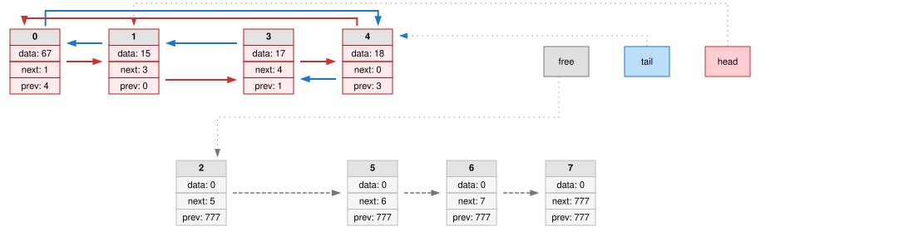

**List: (пере)защищенный двусвязный список**

Перед вами реализация двусвязного списка на массиве структур на языке C с обработкой все(не)возможных ошибок, канареечной и хэш защитами и генерацией графических логов на каждом этапе программы для визуализации работы.

**Умелки списков на основе моего кода:**

* Умеет рождаться (инициализироваться): список "получает" свою память, оборону в виде канареек и готовит нулевой элемент в функции list_init

* Умеет есть (дополнительное выделение памяти): список автоматически расширяется при недостатке мест с помощью функции realloc_up_array

* Умеет ходить (имеет двустронние связи): связи next и prev позволяют эффективно перемещаться по списку, функция iterator_next позволит узнать индекс в массиве следующего элемента, get_head/get_tail определят положение головы и хвоста

* Умеет собирать и разбирать конструктор (добавлять и удалять элементы): в список можно добавить элемент после другого с помощью insert_after и удалить элемент с помощью delete_after

* Умеет убирать за собой (очищать выделенную память): в конце программы настоятельно рекомендуется пользоваться функцией list_destroy, которая сделает всю "грязную" работу за вас

* Умеет отстаивать личные границы (сообщать о неполадках в работе программы): при возникновении ошибок специальные ассерты их сразу же обнаружат и расскажут контекст произошедшего

* Умеет рисовать (делать графические дампы): при каждом действии в html файл записывается итог, а также в папку graphviz сохраняет все картинки по отдельности в формате .svg

**Работа со списками**

*функции*
```cpp
инициализирует список
list_error list_init          (info_about_list* list, size_t size_of_list);

добавляет элемент после определенного места
list_error insert_after_func  (list_iterator_t place_before, list_elem_t value, info_about_list* list);

удаляет элемент после определенного места
list_error delete_after_func  (list_iterator_t place_before, info_about_list* list);

возвращает итератор следующего элемента списка
list_iterator_t iterator_next (info_about_list* list, list_iterator_t iterator);

возвращает итератор головы
list_iterator_t get_head      (info_about_list* list);

возвращает итератор хвоста
list_iterator_t get_tail      (info_about_list* list);

проверяет на все(не)возможные ошибки
int  list_verify_func         (info_about_list* list, const char* func, int line);

дампит текстовый результат в файл, который вы укажите
void list_dump_in_log         (info_about_list* list, FILE* out);

дампит граф в указанный вами файл
void list_dump_dot            (info_about_list* list, const char* filename);

уничтожает и освобождает все после завершения работы со списками
void list_destroy             (info_about_list* list);
```

*макросы*

Для всеотлавливающей работы со списками рекомендую использовать макросы, в которые встроены автоматические дампы в лог файл и создание папки graphviz для удобного рассмотрения картинок

```cpp
INSERT_AFTER(list_iterator_t* place, list_elem_t value, info_about_list* list);
DELETE_AFTER(list_iterator_t* place, info_about_list* list);
```

**Графический дамп**

Графический дамп написан с использованием Graphviz и представляет из себя картинку, показывающую состояние всех элементов массива. Указаны голова, хвост и первый свободный элемент

*пример*



**Запуск программы**

Необходимы компилятор C++ и [Graphviz](https://graphviz.org/)
При сборке введите в терминал:

```bash
 g++ example_of_work/main.cpp list_funcs/list_funcs.cpp hash/hash.cpp -Ilist_funcs -Ihash -o a.exe
 .\a.exe
```

После запуска ожидайте в вашей папке появление list_log.html ([открыть пример list_log.html в браузере](https://molushkax.github.io/lists/example_of_work/list_log.html))- пошагового отчета и папки graphviz/ с .svg файлами ([пример](example_of_work/graphviz))

**Итог**

Проект был написан в учебных целях при изучении основ языка C. При нахождение багов просьба писать на моей страничке в разделе [Issues](https://github.com/molushkax/lists/issues).
